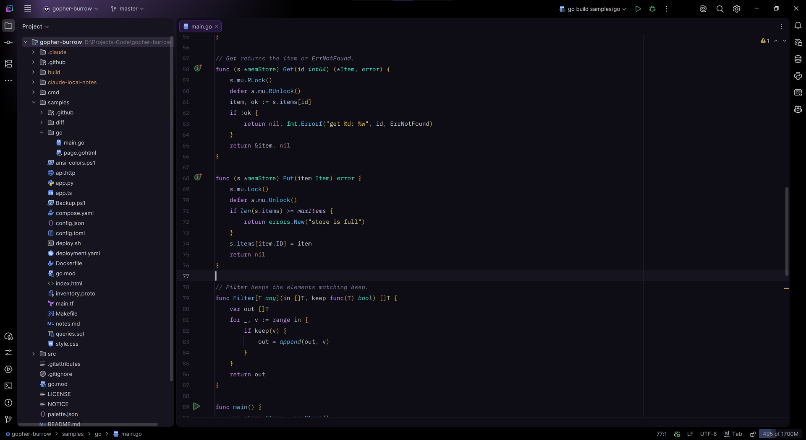

#  Gopher Burrow

[](https://plugins.jetbrains.com/plugin/35081)
[](https://plugins.jetbrains.com/plugin/35081)
[](https://github.com/mg0x7BE/gopher-burrow/actions/workflows/ci.yml)
[](LICENSE)

Dark theme for JetBrains IDEs and Zed.



- Colors tuned for Go and most popular languages.
- Made for GoLand, but I've also tried it in IntelliJ IDEA, Rider, RustRover and CLion, so it should look good there too.
- The Zed version uses the same colors.

## Install

- JetBrains IDEs: Settings > Plugins > Marketplace, search for Gopher Burrow.
- Zed: search for Gopher Burrow in Extensions, or download `gopher-burrow-zed-*.json` from [Releases](https://github.com/mg0x7BE/gopher-burrow/releases) and put it in the Zed themes folder (`~/.config/zed/themes` on macOS and Linux, `%APPDATA%\Zed\themes` on Windows).

## How it works

```
palette.json         colors
CHANGELOG.md         version and release notes, the only place for both
src/jetbrains/       JetBrains templates with placeholders like $gold
src/zed/             Zed templates with placeholders like $gold
  |
  v
go run ./cmd/build   fills the placeholders with colors, version and notes
  |
  +--> build-jetbrains/gopher-burrow-jetbrains-X.Y.Z.jar (gitignored)
  +--> build-zed/ (committed, Zed registry reads it from the repo)
  |      themes/gopher-burrow.json (the theme, also for manual install)
  |
  v
ci.yml               on push or PR: does it build, is build-zed up to date?
release.yml          on push to master: new version in CHANGELOG.md? If yes:
  |
  v
GitHub release with the jar and the Zed theme file

Then by hand:
  --> upload the jar to JetBrains Marketplace
  --> open a PR in zed-industries/extensions pointing to the release commit
```

## License

Apache 2.0
